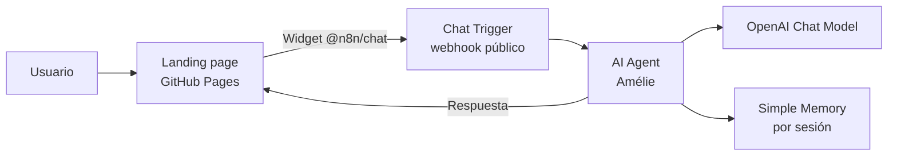

# Café Aroma — Landing page con agente inteligente en n8n

**Sitio web:** https://teffa1808.github.io/Cafe-Aroma/
**Autora:** Steffany Gutierrez · Proyecto académico de posgrado

## Descripción

Landing page de una maison de café y pâtisserie francesa ficticia, con **Amélie**, una anfitriona virtual construida como agente de IA en n8n. Amélie responde consultas sobre la carta y los horarios, recomienda maridajes y gestiona pedidos para recoger, generando un resumen con total y un código de confirmación.

## Arquitectura

| Componente | Función |
|---|---|
| Landing page (HTML/CSS/JS) | Interfaz pública, estática, publicada en GitHub Pages |
| Widget `@n8n/chat` | Integra el chat en la web y envía cada mensaje al webhook |
| Chat Trigger (n8n) | Punto de entrada público que recibe el mensaje y el ID de sesión |
| AI Agent (n8n) | Orquesta la conversación según el *system prompt* de Amélie |
| OpenAI Chat Model | Modelo de lenguaje que genera las respuestas |
| Simple Memory | Conserva el contexto de cada conversación |

## Diseño del agente

El comportamiento se define mediante *prompt engineering* en el *system message* del AI Agent:

- **Personalidad:** anfitriona cálida, con toques de francés y respuestas breves.
- **Base de conocimiento:** carta completa con precios, horarios y políticas.
- **Recomendaciones:** reglas de maridaje café–pâtisserie y sugerencia del día.
- **Flujo de pedidos:** confirma productos, calcula el total, solicita nombre y hora de recojo, y emite un código `CA-XXXX`.
- **Límites:** solo responde temas de Café Aroma y no deriva a canales externos.

## Seguridad

- El código público no contiene claves API ni credenciales.
- Las credenciales del modelo se gestionan dentro de n8n (en el `.json` exportado figuran como referencia vacía).
- El webhook del chat es público por diseño, ya que es necesario para que el widget funcione.

## Archivos

| Archivo | Contenido |
|---|---|
| `index.html` | Landing page con el chat integrado |
| `portada.jpg`, `maison.jpg`, `cafe.jpg`, `salon.jpg` | Imágenes del sitio |
| Flujo n8n (`.json`) | Entregado por separado en la plataforma del curso |
